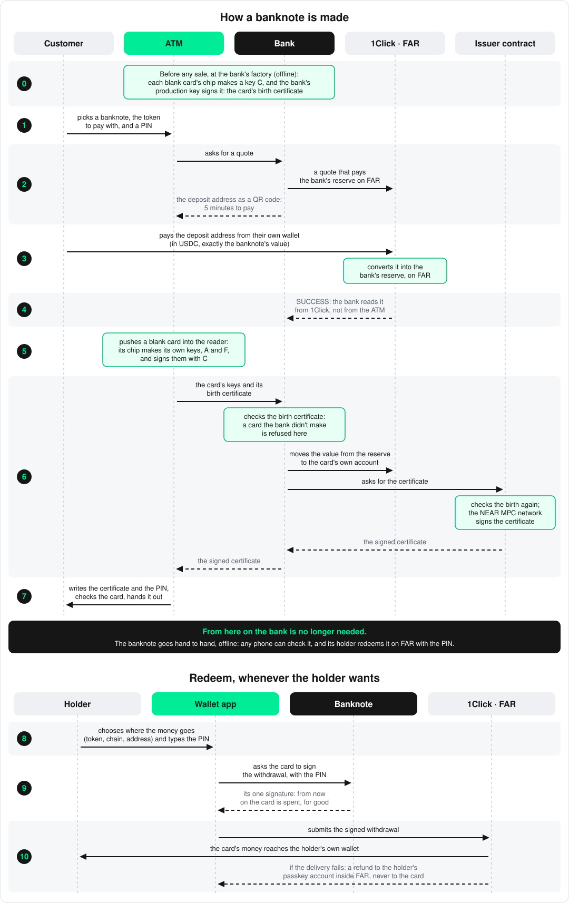
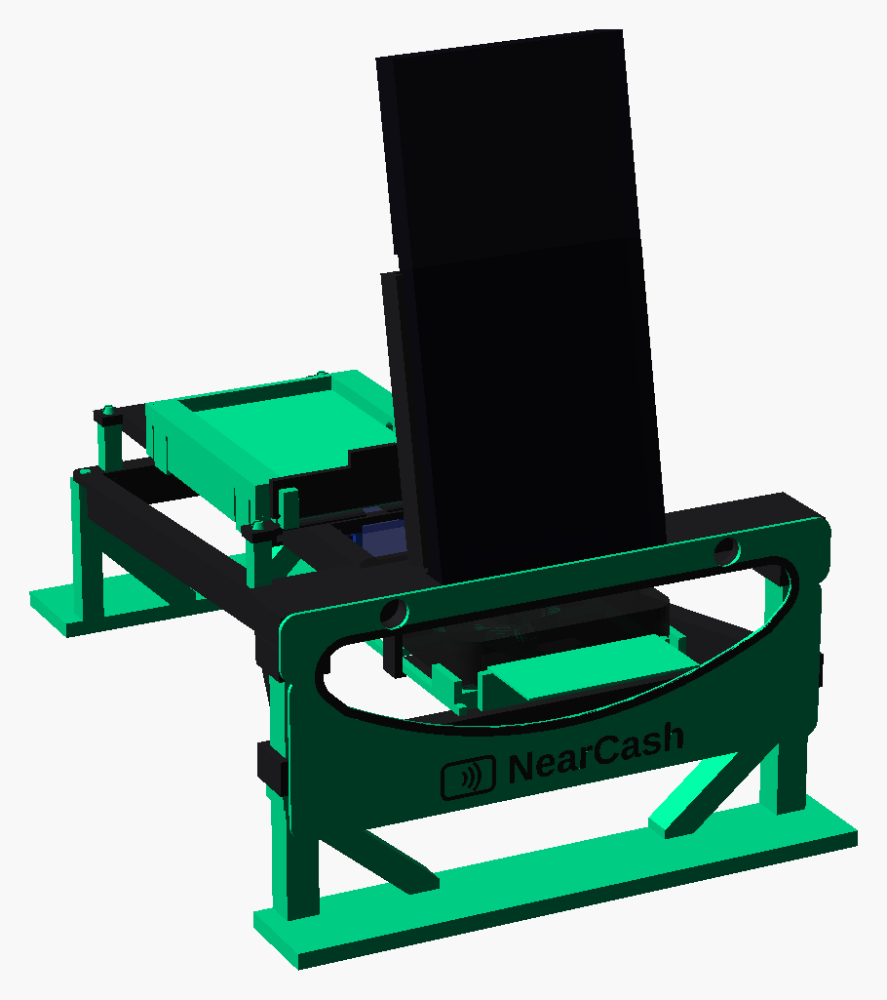

# NearCash

Today almost all money, crypto included, is reached through someone's
servers: a bank's app, an exchange, a wallet provider, a cloud region. When
one of them is hacked, patched in a hurry, fails or is switched off, people
can't pay or withdraw, even when their money is safe. The more payments move
to apps, the more money depends on those servers. In the last few weeks
alone:

- **Binance**, the world's largest exchange, halted withdrawals after a
  $6.3 billion theft, from 29 October to 1 November 2026
  ([France 24](https://www.france24.com/en/business/20261101-binance-says-resuming-withdrawals-after-major-hack)).
- **Mercado Bitcoin** stopped deposits and withdrawals "as a precaution"
  after a security incident on 2 November 2026, with no date given for
  their return
  ([The Rio Times](https://www.riotimesonline.com/brazil-mercado-bitcoin-halts-withdrawals-security-incident-2026)).
- Two critical flaws in **PHP** led governments, banks and brokers to take
  websites and online services offline while they patched, on 21–22 October
  2026
  ([The National](https://www.thenationalnews.com/news/europe/2026/10/22/uk-orders-dozens-of-official-websites-offline-after-flaw-warnings)).
- A power failure in **Google Cloud**'s London region stopped Revolut card
  payments, transfers and cash withdrawals on 19–20 October 2026. Revolut
  said its customers' money was safe; for hours, some of them couldn't use
  it
  ([The Irish News](https://www.irishnews.com/news/uk/banks-and-courts-affected-by-disruption-as-google-apologises-for-cloud-outage-NGVJFIJO7NK47DX5KKSFPTUGNQ/)).

Cash is the one kind of money that keeps working when they go down, and it
is used less and less. NearCash brings its properties to digital money: a
banknote you hold, check and hand over with no server, no account and no
connection. It is possible now because NEAR Intents can hold each banknote's
value privately (FAR), and the NEAR MPC network can certify banknotes without
anyone holding the key.

A NearCash banknote is an NFC card. Its value sits in the card's own account
on FAR, the private variant of NEAR Intents, and only the card's chip can
spend it: once, with the holder's PIN.

**The bank is trusted for one thing: making banknotes.** It prepares each
blank card by installing the applet on its chip, then issues it by funding
its account and having it certified. From then on the banknote doesn't need
the bank: checking it, handing it over and redeeming it involve only the
card, a phone and FAR. Handing one over is as private as paying in cash: two
people, offline, nothing recorded on a server or on-chain.

## The system



**The banknote** (`applet/`) is an NFC Java Card (NXP JCOP4 J3R180) running
the NearCash applet. Its keys are born in the chip and never leave it:
key **A** proves the card is genuine, key **F** owns the card's account on
FAR and signs exactly once, with the holder's PIN, to redeem it. Key **C**
is made at the bank's factory, where the bank's offline production key signs
it (the card's birth certificate): C signs A and F when they are born, so
only keys from a chip the bank made can be certified. A card goes from
blank, to issued, to spent, and never back.

**The issuance server** (`apps/issuance`) is the bank: the only place where
banknotes get their value. For each sale it asks 1Click for a quote that pays
the bank's reserve inside FAR (in USDC, on any chain, the customer sends
exactly the banknote's value: the bank pays the conversion), checks the
payment itself (it never believes an ATM), checks the card's birth
certificate, moves the banknote's value from the reserve to the card's own
account, and has the certificate signed. One payment buys exactly one card.
It also gives back what can't become a banknote (a failed swap, a payment
after the deadline, an overpayment): the money returns to the address that
paid, on the same chain and in the same token. Amounts smaller than the
network fee of sending them back are kept.

**The issuer contract** (`contracts/issuer`) is a NEAR contract that only the
issuance server may call. It writes each certificate itself and has the
**NEAR MPC network** sign it. That signature is what makes a banknote, and
MPC changes how its key is kept: the key is split among the network's
independent nodes, a signature needs many of them to agree, and no node,
server or person ever holds it whole. There is no key file to steal and no
employee who could leak it: forging banknotes would mean compromising enough
of those nodes at the same time, far harder than breaking into one bank
server. Breaking into the issuance server gives only what the contract
allows, because it also bounds the bank: only chips the bank made, each
certified once, only set denominations, a daily cap,
the issue date rounded to the day, public counters, and access that can be
revoked at once, without changing the key in any wallet.

**The ATM** is a Raspberry Pi with an NFC reader, a cassette of blank cards,
a dispenser and an iPhone as its screen. It holds no key that creates value:
a stolen cassette is a stack of blank plastic.
- The **ATM server** (`apps/atm`) runs the sale: it asks the issuance server
  for the quote and the certificate, writes it with the customer's PIN on a
  blank card, verifies the card like a receiver would, and dispenses it.
- The **body** (`hardware/atm`) is 3D printed in two colours. Blank cards
  wait in a hopper; a pusher slides the bottom one into the reader, which
  sits on a turret. Once the banknote is issued, the turret turns round and
  hands it out of the ATM's smiling mouth.
- The **kiosk page** (`apps/kiosk`) is what the iPhone shows: the customer
  picks a banknote, then the network and the token to pay with (USDC, ETH or
  SOL), and chooses a PIN. The screen then shows only the QR code of the
  deposit address, which the customer scans with the phone they pay from; an
  animation confirms the deposit, and the banknote is made. Whoever pays from
  an exchange adds their own refund address, since the exchange's sending
  address isn't theirs. The Pi serves the page over HTTPS to its paired
  screen only.



Everything about the ATM's body, from the parts to buy to printing, assembly
and motion, is in [hardware/atm/README.md](hardware/atm/README.md).

**The wallet app** (`ios/`) is a native iPhone app. It checks a banknote
offline over NFC — that it is issued and unspent, that its certificate is
signed by the issuer, that the certificate belongs to this chip, and that the
chip answers a fresh challenge — and lets the receiver take it over by
changing the PIN. It also redeems a banknote: the holder picks a token, a
chain and an address, the card signs once, and 1Click delivers the value
there. If the delivery fails, the value goes back not to the card, which can
no longer sign, but to the holder's refund account inside FAR, held by a
passkey of the app (iCloud Keychain, Face ID), from which the app withdraws it.

**The website** (`apps/website`) explains the problem NearCash solves: money
held through apps stops when their servers are hacked, patched or switched
off. It then shows what runs today, what NEAR gives it, and the business.

Shared code lives in `packages/` (the card protocol, certificates, the MPC
signer, the sale flow, what the kiosk and the ATM server share). The protocol
itself is specified in [docs/protocol.md](docs/protocol.md).

## A banknote's life

1. **Sale.** The customer pays at the ATM. The money reaches the bank's
   reserve; the issuance server funds a blank card's account from it and the
   NEAR MPC network certifies the card. The banknote comes out of the ATM.
2. **Circulation.** Hand to hand, with no network at all. The receiver's
   phone checks the banknote; after the deal the giver tells the PIN and the
   receiver changes it.
3. **Redemption.** With the PIN, the card signs once to send its value to an
   address of the holder's, in the token and on the chain they choose. The
   card is spent from that moment. If the delivery fails, the value lands in
   the holder's refund account inside FAR, held by a passkey of the wallet
   app, never back on the card.

The bank takes part only in making the banknote: it prepares the blank cards
before they go into an ATM, and it issues them in step 1, which the issuer
contract limits. From step 2 on it plays no role: it is not asked to check a banknote,
it is not asked to approve a transfer or a redemption, and if it went
offline, or disappeared, banknotes already issued would keep working.
Nobody can block, freeze or switch off a banknote in someone's pocket.

Nothing public links a buyer to a banknote: the payment goes to the reserve,
the card is funded inside FAR, and the certificate carries only the day.

## Next: a bank nobody has to trust

Today the issuance server is the one part of NearCash that must be trusted:
it holds the reserve's key, and the issuer contract believes it when it says
a card has been funded. The contract bounds it (only chips the bank made,
denominations, a daily cap, public counters, revocation), but it cannot
check the funding itself: it can't see inside FAR.

The issuance could run on [OutLayer](https://docs.near.org/primitives/off-chain-compute/outlayer),
verifiable off-chain compute for NEAR: code runs inside Intel TDX enclaves,
and every run carries an attestation of the code, its input and its output.

- **The reserve's key would be born in the enclave and never leave it.**
  OutLayer derives ed25519 keys inside the TEE and signs NEP-413 messages
  with them, the same kind of key and signature the reserve already uses in
  FAR. Bound to one exact build, the key signs only what that audited code
  allows: no operator, employee or intruder could move the reserve.
- **Only that code could have certificates signed.** It would ask for one only
  after reading the payment's `SUCCESS` from 1Click itself, funding the card
  inside FAR and seeing that transfer settle. An unbacked banknote would be
  impossible to make, not just bounded.
- **The issuance rules would hold by construction:** one payment buys one
  card, a card is never funded twice, a refund goes back only to the address
  that paid.
- **It fits the issuance as it is:** a few calls to 1Click over HTTPS and one
  NEAR call per sale, well within what an OutLayer run can do.

With MPC already signing the certificates, no single party would hold a key
that creates or moves value. What would still be trusted: Intel's hardware
and OutLayer's attested workers (which can stop running new sales, but never
touch banknotes already issued), 1Click's answers about payments, and the
issuer contract's owner, whose power to add minters would have to be locked
or time-locked.

## Run it on a computer

A whole sale runs on one computer, with no card, no keys and no money: the
NearCash applet runs in a card emulator in place of the ATM's reader. It
needs Node.js 22.18 or later, pnpm 10 (`corepack enable` provides it) and
Java 17 or later.

```bash
pnpm install
pnpm test        # the card protocol, the issuance server, the ATM server, the kiosk API
pnpm local       # starts the card emulator, the issuance server, the ATM server and the kiosk page
```

`pnpm local` prints the address of the kiosk page, the ATM's screen
(http://127.0.0.1:5190). Pick the banknote, a way to pay and a PIN, press
"Simulate the payment", and follow the steps until the banknote is handed
out.
In another terminal, `pnpm local:sale` makes the same sale through the same
API, without a browser. Then it checks the banknote handed out, as the
wallet app would, and hands it over to a new holder by changing its PIN. It
exits with code 0 when all of it passes. Ctrl-C stops everything.

Every step of the sale runs for real:

- the blank card creates its keys inside the applet;
- the issuance server checks the chip's birth certificate, funds the card's
  account and signs its certificate;
- the ATM writes the certificate and the PIN, then checks the card as a
  receiver would.

Three things are stood in for:

- **The card:** each one comes from the card emulator
  (`applet/src/emulator`), which runs the real applet in jCardSim. Its
  chips are born with a public development production key.
- **Payments and the reserve:** simulated. No 1Click, no FAR, no money.
- **Certificates:** signed by the issuance server with a public development
  issuer key, not by the NEAR MPC network. It sells one test banknote of
  0.01 ETH.

It never reads `.env.issuance` or `.env.atm`, it uses its own ports (8890,
8892, 8893, 5190), and it needs no network after the first run, which
downloads Gradle and jCardSim.

The other parts are tested with their own tools:

| Part | Needs | Command |
| --- | --- | --- |
| The card's applet (`applet/`), in the jCardSim emulator | Java 17 or later | `pnpm applet:test` |
| The issuer contract (`contracts/issuer`) | Rust (rustup installs the pinned 1.96) | `cd contracts/issuer && cargo test` |
| The wallet app (`ios/`), in the iOS Simulator | macOS, Xcode 26, XcodeGen | `pnpm ios:generate`, then `cd ios && xcodebuild test -project NearCashWallet.xcodeproj -scheme NearCashWallet -destination 'platform=iOS Simulator,name=iPhone 17'` |
| The website (`apps/website`) | — | `pnpm website:dev` (http://localhost:5180) |

Real banknotes need the hardware: Java Cards, the NFC reader and the
Raspberry Pi. Real payments need a 1Click partner key. Certificates signed
by NEAR MPC need a NEAR account that the issuer contract accepts as a
minter.

## Deploy the ATM

```bash
pnpm atm:demo <user>@<raspberry-address>
```

It installs what the Raspberry Pi needs, deploys the ATM server and the
kiosk page there and starts them in a tmux session on the Pi. The issuance
server and the website run on this computer. Then it opens a tmux session
here with all of them, and prints the address to open on the iPhone, its
pairing QR code and the command to reach the Pi's session. The Pi's password
is asked only the first time.

The ATM sells only while a blank banknote is on the NFC reader; otherwise the
kiosk shows "Out of service": the ATM never takes a payment it can't turn
into a banknote. `pnpm atm:reader` checks the reader and the card on it.
Every blank card needs a birth certificate from the bank's production key
first (`pnpm card:birth`); for a demo with cards that never got one, add
`--skip-mpc --skip-birth`.

Before the reader arrives, `pnpm atm:demo --dummy-reader <user>@<raspberry-address>`
tests the whole sale with the printed dummy reader in the turret. Once a sale
is paid, the servos hand out a blank card: nothing is written on it and
nothing is issued, and the sale stays paid at the issuance server.
