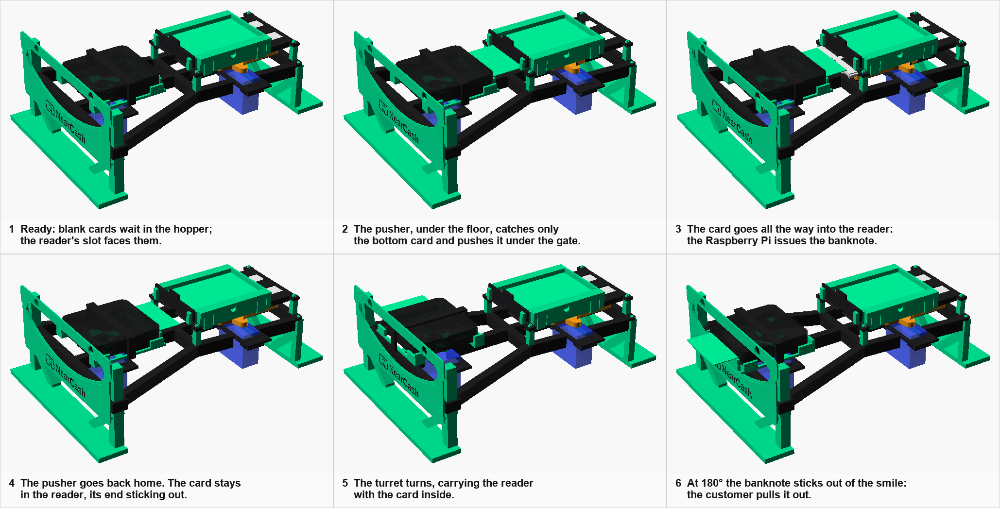
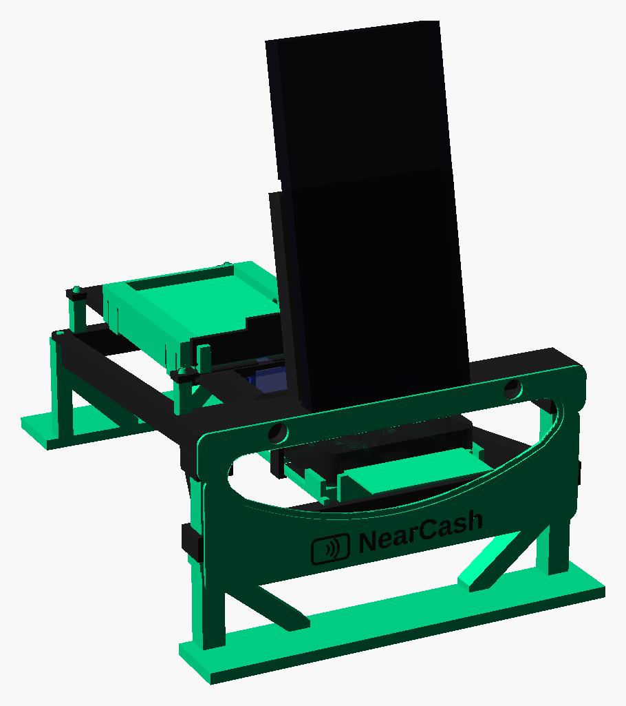
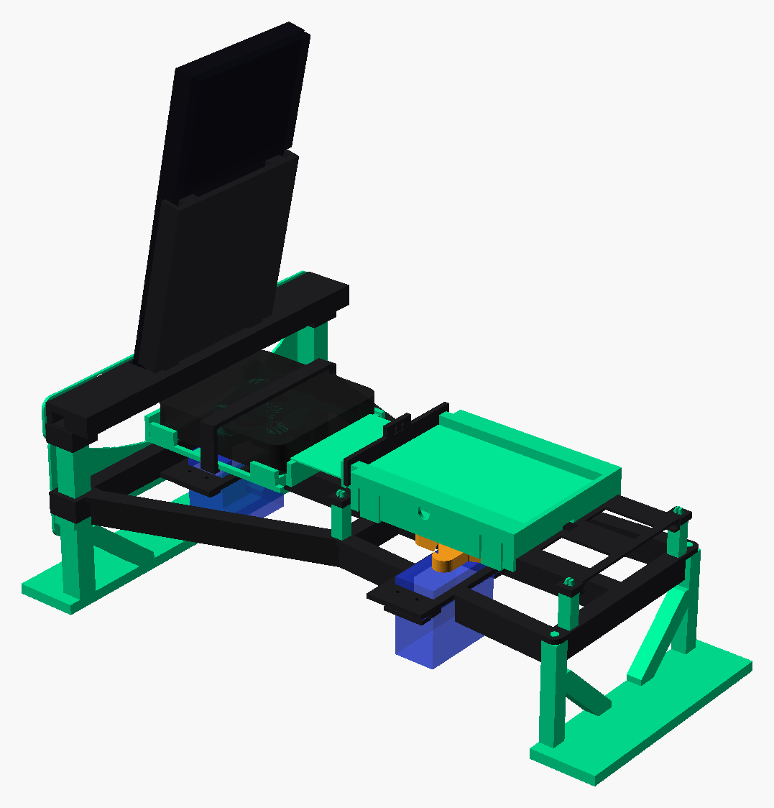

# The NearCash ATM, printed

A desktop ATM that prints in about six hours on a Bambu Lab X2D. An iPhone
standing on top is its screen. Blank cards wait in a hopper; when a sale is
paid, a pusher slides the bottom one into the card reader, the Raspberry Pi
turns it into a banknote, and the reader, on a turret, spins round to hand the
banknote out through the smile on the front.



| From the front | From the back |
|---|---|
|  |  |

## How a card goes in, and how it comes out

1. **In.** The reader's slot faces the hopper. A carriage under the channel
   floor, moved by a lever on a servo, catches the bottom card with a 0.6 mm
   finger (thinner than a card, so it never takes two). It pushes the card out
   of the hopper, under the gate, across a short gap and all the way into the
   reader.
2. **Issue.** The Raspberry Pi talks to the card through the reader.
3. **Back.** The pusher returns home. The ramp on the back of its finger slides
   under the next card. The issued card stays in the reader, about 25 mm of it
   sticking out.
4. **Out.** The turret turns 180°, carrying the reader with the card in it. The
   end that stuck out towards the hopper now sticks out of the smile by about
   30 mm, and the customer pulls the banknote out of the reader, as at any ATM.
5. **Ready.** When the reader reports the card gone, the turret turns back.

The machine never pulls the card out itself. The ACR39U is a contact reader
with a pocket slot: a card can only leave it the way it went in, against the
grip of its contacts, and printed parts (no rubber rollers) can't hold a card
firmly enough to drag it out. So the ATM turns the reader round and lets the
customer take the card.

If a card fails its check, the turret doesn't turn. The card stays in the
reader, and the ATM is out of service until the operator takes it out.

## The phone: the ATM's screen

The iPhone stands above the smile, leaning back by 12°, and shows the kiosk
page. It stands in a groove in a shelf and leans on a back with two rails.

- **What carries it.** Two tall posts (10 × 10 mm) go from the table up
  through the chassis, which holds each one upright in an 8 mm sleeve. The
  shelf fits over their tops with two sleeves of its own, so the joint doesn't
  rock, and the back's rails go 8 mm deep into the shelf's sockets. The posts
  stand outside the circle the banknote sweeps, so nothing touches the turret.
- **The weight.** The phone weighs about 200 g. The phone leans back,
  so its weight presses every joint the same way a tap on the screen does: the
  play in the fits is taken up and nothing rattles. The stresses are tiny for
  PETG (about 0.4 MPa in the shelf, about 3 MPa in the posts under a firm 5 N
  push at the top of the phone).
- **Tipping.** The whole ATM weighs about 650 g and the phone sits high. It
  stays up when a customer pulls the banknote out (up to about 5 N) and under
  normal taps, but a hard push at the top of the phone (about 4–5 N backwards,
  about 2 N sideways) could tip it. Stick its four feet to the counter with
  double-sided tape, or put a weight on the chassis behind the hopper.
- **Charging.** The shelf has a pocket for the plug and a groove that takes the
  cable out to the side: use a cable with a right-angle plug.

The defaults fit an iPhone 17 Pro without a case: it stands 5 mm deep in its
groove, and the back holds it up to just below its camera plateau. For
another phone, or one in a case, set `phone_width`, `phone_thickness`,
`phone_height` and the plateau's `phone_bump_t` and `phone_bump_len` to yours.

## What you need

| | |
|---|---|
| Card reader | ACS ACR39U-U1 |
| Servos | 2 × MG996R (180°), with their cross horns, horn screws and mounting screws (4 per servo, in its bag) |
| Servo power | 4 AA batteries in a holder (NiMH rechargeables: 4.8 V), or a 5 V supply of at least 3 A; it powers the servos only, never through the Pi |
| Wiring | A small breadboard, 4 male–male and 3 male–female jumper wires: the servos' signals go straight to the Pi's pins, with no driver board |
| Controller | Raspberry Pi 4 or 5, with its own power supply; it sits next to the ATM |
| Cards | Blank NXP J3R180 cards (85.6 × 54 × 0.76 mm), with the applet installed |
| Screen | An iPhone 17 Pro without a case (another phone: set its size at the top of the model), and a charging cable with a right-angle plug |
| Filament | PETG, about 223 g: 106 g green, 117 g black |

No glue and no metal in the structure: the parts fit with printed pegs and
rails. The only screws are the servos' own: four hold each servo to the
chassis (through a printed plate under each tab), one holds each horn.

## Printing

Open **`nearcash-atm.3mf`** in Bambu Studio: every part is already on its
plate, in its colour, with the settings (X2D 0.4 mm nozzle, 0.24 mm layers,
2 walls, 15 % infill, PETG Basic, textured PEI plate). Bambu Studio's estimate:

| Plate | Time | Filament |
|---|---|---|
| 1. Test pieces (print these first) | 15 min | 7 g |
| 2. Spare: the other gates, 0.9, 1.0 and 1.2 (only if 1.1 doesn't work) | 14 min | 7 g |
| 3. Black: the lever and the reader's strap | 14 min | 6 g |
| 4. Test: the horn pocket alone (to try the horn's fit again) | 6 min | 2 g |
| 5. Green: the legs, front and back (each a pair of posts on a wide base) | 74 min | 47 g |
| 6. Black: the plates under the servos' tabs | 5 min | 1 g |
| 7. Green: the channel floor (freer rails) and the carriage | 34 min | 17 g |
| 8. Black: the chassis, with ribs under its bars and side bars | 101 min | 56 g |
| 9. Black: the phone holder (shelf and back) | 69 min | 42 g |
| 10. Green: the channel posts (a ribbed peg into the chassis, a snap head through the floor) | 8 min | 2 g |
| 11. Green: the hopper (it hooks under the floor's rails) | 36 min | 18 g |
| 12. Black: the gate (it snaps onto the hopper's pillars) | 5 min | 2 g |
| 13. Green: the reader's holder (the turret), its hub's middle open so the horn pocket's ceiling prints cleanly | 23 min | 9 g |
| 14. Green and black: the face, with black lips round the smile and the NearCash name and logo flush in black under it (the AMS swaps the colours on nozzle 1 for its first three layers) | 32 min | 15 g |
| **The ATM** (plates 3 and 5 to 14) | **6 h 41 min** | **215 g** |

Add a few minutes per plate for the printer's own warm-up and calibration,
which the estimate leaves out. None of the parts needs supports. The
project sets Bambu Studio to keep travel moves inside the parts (Avoid
crossing walls), so PETG leaves fewer strings in the holes and grooves; if
the filament still strings a lot, dry it.

The STLs in `stl/` are the same parts, each one already lying the way it
prints, if you want to arrange the plates yourself:

| Part | Qty | Colour |
|---|---|---|
| `chassis` | 1 | black |
| `legs_back` | 1 | green (the two short posts at the back, on one base) |
| `legs_front` | 1 | green (the two tall posts at the front, on one base) |
| `phone_shelf`, `phone_back` | 1 each | black |
| `channel_post` | 4 | green (they lock the floor down: a ribbed peg into the chassis, a snap head through the floor) |
| `channel_floor` | 1 | green (prints upside down: the cards slide on the face on the bed, so the smooth plate, with glue stick for PETG, is best; the textured one works too) |
| `hopper` | 1 | green (it snaps onto the floor: four fingers hook under the rails, the front pads stop it going forward) |
| `gate_1_1` | 1 | black (it snaps onto the hopper's front pillars; `gate_0_9`, `gate_1_0`, `gate_1_2` are spares with other gaps, on plate 2; each has its gap engraved on the hopper side) |
| `carriage` | 1 | any (it hides under the floor; the project prints it green) |
| `lever` | 1 | black |
| `turret` | 1 | green |
| `turret_strap` | 1 | black |
| `servo_clamp` | 4 | black (one under each servo tab) |
| `face` | 1 | green, with `face_brand`, its black lips and NearCash name and logo, printed in it as one object |
| `test_fit`, `test_reader` | 1 each | any |
| `test_horn` | 1 | any (the horn pocket of `test_fit` alone) |

## Before the ATM: measure, and print the test pieces

The model is parametric: everything follows the values at the top of
`nearcash-atm.scad`. The defaults are estimates. `card_insert_depth` matters
most: what sticks out of the reader swings round with the turret, and the
channel, the hopper and the smile are placed around that circle with a 4 mm
margin. A card that goes in less deep swings wider, so measure it before
printing.

| Value | How to measure it | Default |
|---|---|---|
| `card_insert_depth` | Push a card fully into the reader and measure what sticks out. The depth is 85.6 minus that. | 60 mm |
| `reader_w`, `reader_l`, `reader_h` | The reader: width, length (slot to cable end) and height. Its pocket on the turret has 0.3 mm of play (`reader_fit`). | 69, 72.2, 14.5 mm |
| `reader_slot_bottom` | With the reader flat on the table and a card in it, the height of the card's lower face above the table. | 6 mm |
| `horn_span`, `horn_arm`, `horn_arm_tip`, `horn_t`, `horn_boss_d` | The cross horn that comes with the servo (the printed parts press onto it). Its arms taper: tip to tip, an arm's width 8 mm from the centre and just before its rounded end, thickness, and the middle across the curved corners between the arms. | 36, 7.9, 4.7, 3.6, 14.8 mm |
| `horn_gap` | With the horn on the servo: from the top of the servo's case to the underside of the horn's arms. It sets the height of the lever and of the turret. | 2.3 mm |
| `servo_tab_top` | From the servo's bottom to the top face of its mounting tabs. | 29 mm |
| `phone_width`, `phone_thickness`, `phone_height`, `phone_bump_t`, `phone_bump_len` | The phone (with its case, if it has one), and its camera plateau: how far it stands out and how far down it reaches. | 71.9, 8.75, 150, 4.5, 55 mm (iPhone 17 Pro) |

Then print plates 1 and 4 and try the three test pieces:

- **`test_reader`**: lay the reader flat on the table, put the piece against
  its slot and slide a card along its rails. The card must go into the slot
  without catching its edge and without lifting. If it doesn't, correct
  `reader_slot_bottom`.
- **`test_horn`** (plate 4): press a servo horn into the cross pocket: snug,
  with no play, since that fit alone holds the turret on its servo. If it is
  too tight or too loose, change `horn_fit` at the top of the file.
- **`test_fit`**: push the peg into its hole (firm); slide the slice of
  carriage into the length of rail (free, without wobbling). If a fit is too
  tight or too loose, change `fit` (sliding) or `press` (pegs).

If you changed a value, regenerate everything and check it:

```bash
hardware/atm/export.sh            # STLs and images
hardware/atm/check-clearances.sh  # nothing touches, at any position
python3 hardware/atm/make-3mf.py  # the Bambu Studio project
python3 hardware/atm/make-instructions.py  # the assembly instructions (PDF)
```

Pass the values with `-D`, for example `-D card_insert_depth=58.5`, to the
first two (or change them in the file).

## Assembly

1. **Servos.** Wire the servos first (below) and find each servo's rest:
   0° for the turret; for the pusher, 0° if its shaft turns anticlockwise
   (seen from above) as the angle goes up, 180° if it turns clockwise (the
   ATM server then uses 180° minus the angle). At rest, fit the cross horns
   with their screws, their arms along and across the servo. Push each servo up into
   its hole in the chassis, shaft up, at the end of the hole nearest the
   middle. Lay a `servo_clamp` plate on each tab and screw the servo on with
   the four screws from its bag, through the plates and the tabs' slots into
   the chassis (the slots are made for rubber grommets: a screw head alone
   could slip through them).
2. **Legs.** Press the back legs' two pegs into the chassis' underside at the
   back, their base reaching backwards. Push the front legs' two tall posts up
   through the sleeves at the front, their base reaching forwards (the face's
   peg holes face forward), until the sleeves rest on the collars. Stand the
   chassis up: it stands on the two bases.
3. **Lever.** With the pusher at rest, press the lever onto the middle
   servo's horn, pin up, pointing to the back. Going from rest to the other
   end it must swing towards the middle of the ATM (anticlockwise, seen from
   above), so that its pin stays in the carriage's slot.
4. **Channel.** Slide the carriage into the channel floor's rails from the
   front (the turret's end), finger up through the slot and towards the
   front: the slot is open only at that end. Press the four channel posts into the
   chassis, ribbed peg down (the ribs grip the holes), then set the floor on
   them, guiding the lever's pin into the carriage's slot, and press it down
   until each post's split head clicks over the floor.
5. **Hopper.** Press the hopper onto the floor, its outer walls down the
   floor's sides just behind the front pads, until its four fingers click
   under the rails. Slide the gate down the slots in the hopper's front
   pillars, number towards the hopper, until its two arms click under the
   steps on the pillars. To change the gate, spread its arms and pull the tab.
6. **Turret.** Lay the ACR39U in the turret with its slot towards the hopper and
   its cable towards the front, snap the strap over it, and press the turret
   onto the front servo's horn (still at 0°) with the slot towards the hopper.
   Leave the cable a slack loop so the turret can turn half a turn.
7. **Face.** Push the face's two pegs into the tall posts.
8. **Phone.** Press the shelf onto the tall posts' tops (it passes over the
   turret), then slide the back's rails into the shelf's sockets. Put the
   right-angle plug in its pocket, run the cable out along the groove to the
   side, and stand the phone in the groove, leaning on the back.
9. **Cards.** Load blank cards with the chip end towards the gate (that end goes
   into the reader first), the chip facing the way the reader takes it (try
   one by hand).

Wire the servos straight to the Pi: the turret's orange signal wire to GPIO 12
(pin 32), the pusher's to GPIO 13 (pin 33), their red and brown wires to the
batteries' + and −, and the batteries' − to a GND pin of the Pi too (pin 34),
or the servos can't read the signal. Their pulses come from the Pi's hardware
PWM, turned on by the line `dtoverlay=pwm-2chan,pin=12,func=4,pin2=13,func2=4`
in `/boot/firmware/config.txt` (`pnpm atm:demo` adds it; reboot once): without
it, `hardware/atm/servo_driver.py` falls back to software pulses and the servos
twitch. `pnpm atm:servos` (on the Pi) turns both
servos to 0° and holds them there; `pnpm atm:servos 13 90` turns one (GPIO 12
is the turret, 13 the pusher). `nearcash-atm-assembly-en.pdf` (and `-it.pdf`,
in Italian) has every step with its picture and the wiring. Keep fingers out
of the smile while the turret turns.

## Motion, for the ATM server

The ATM server drives the reader (PC/SC) and the two servos (the Pi's hardware PWM on GPIO 12 and 13):

| Step | Turret (GPIO 12) | Pusher (GPIO 13) | Waits for |
|---|---|---|---|
| idle | 0° (slot to the hopper) | 0° (home) | a paid sale |
| load | 0° | 0° → 180°, slowly | the reader: card present |
| back | 0° | 180° → 0° | |
| issue | 0° | 0° | the banknote issued and checked |
| hand out | 0° → 180° | 0° | the reader: card removed |
| ready | 180° → 0° | 0° | |

The pusher's angles are for a pusher whose rest is 0°; for one whose rest is
180°, use 180° minus each. The pusher must be home before the turret turns: at full stroke its finger is
inside the banknote's sweep. Calibrate each servo's end angles: the pusher's
180° must put the card at full depth without pushing on the reader's end stop.

To find an end angle, `pnpm atm:servos 12 0` holds the turret and moves it as
you type (`+1`, `-1`, or an angle): the horn's splines leave the turret a few
degrees off at 0°. `pnpm atm:cycle` (on the Pi, `hardware/atm/cycle.py`) runs
this whole sequence on the servos to test the mechanics, with the reader in the
turret and pauses standing in for the reading and the issuing: `--dry-run` prints the steps, `--cycles N` repeats it, and `--stroke`,
`--turret-in`, `--turret-out` and `--pusher-reversed` take the calibration. Both
scripts move the servos calmly from where they were left (noted on the Pi in
`~/.nearcash-atm-servos.json`, since a servo can't tell where it is), always the
pusher home before the turret turns; `cycle` starts and ends at rest and goes
back to rest on Ctrl+C (a second Ctrl+C lets the servos go limp at once).

## How we know the design is right, and what is left to check

Checked on the computer, every time the files are generated:

- `check-clearances.sh` intersects the parts that must never touch: the
  carriage in its rails and the lever's pin in its slot at nine positions of
  the stroke, the lever's swing, the turret with the banknote at every 10° from
  0° to 180°, every fit (posts, pegs, gate, servos and their screws), and the phone in
  its groove with the back's rails in their sockets. It fails if any two
  overlap by more than resting on each other, or if a part's STL isn't one
  piece (a part with a gap in it would come off the bed in pieces).
- The carriage is long enough that the lever's off-centre push can't lock it
  in its rails, like a drawer pulled by one corner, unless the friction is
  above 0.42 (PLA on PLA is about 0.3–0.4; there is no good figure for PETG
  on PETG). A little dry PTFE lubricant on the rails adds margin.
- Every STL is closed, lies flat on the bed and fits it, and nothing starts
  in mid-air: the only surfaces printed over air are short bridges, the
  round undersides of the posts' pegs, and overhangs of up to 2 mm. Bambu
  Studio slices every plate without errors or warnings.

What only the real parts can tell, and how to find out quickly:

- Real dimensions (the reader's slot height and depth, the servo and its horn):
  the measurements and the two test pieces, in 15 minutes of printing.
- Whether a card slides in easily, and only one leaves the hopper: move the
  pusher in small steps with the floor mounted, with the gate that works.
- The servos' range and force: move each one with a short test script before
  the whole sale, and calibrate the end angles.
- Whether the phone stands firm: stand it in place and tap and swipe the whole
  screen, as a customer would, before taping the feet down.

## Files

- `nearcash-atm.scad`: the model; `part = "assembly"` shows it all in place.
- `nearcash-atm.3mf`: the Bambu Studio project (made by `make-3mf.py`).
- `export.sh`: writes `stl/` and `images/` (`crop.py` trims the renders,
  `sequence.py` composes the journey).
- `check-clearances.scad`, `check-clearances.sh`, `stl-volume.py`, `stl-pieces.py`: the checks.
- `nearcash-atm-assembly-en.pdf`, `nearcash-atm-assembly-it.pdf`: the assembly
  instructions, made by `make-instructions.py` from `assembly-steps.scad`.
- `servo.py`: moves the servos by hand, on the Pi (`pnpm atm:servos`).
